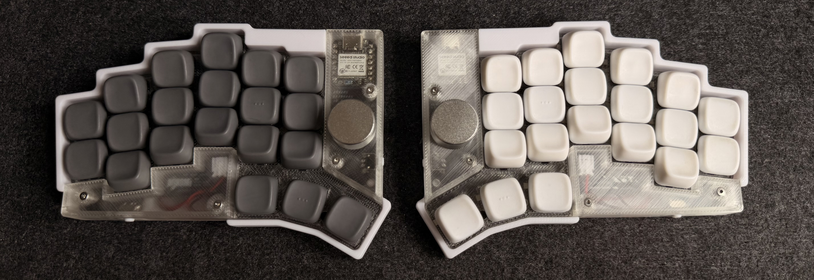
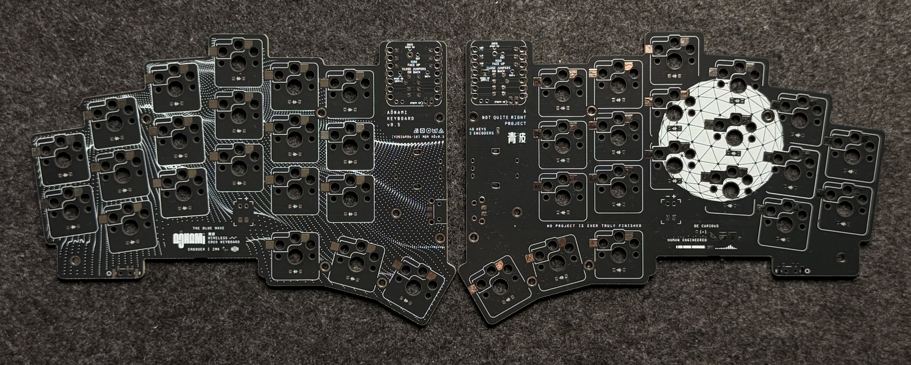
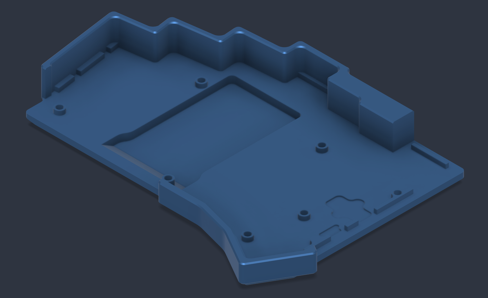
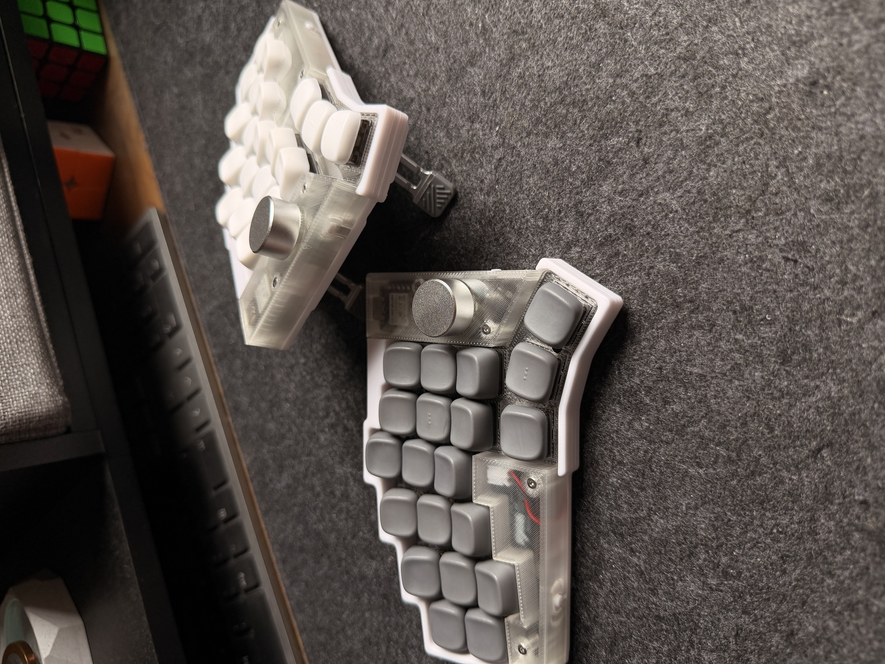
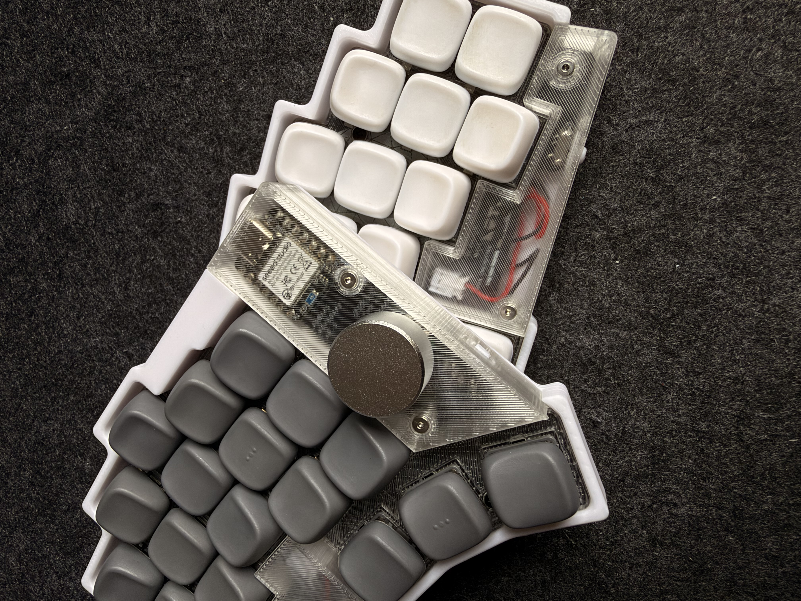
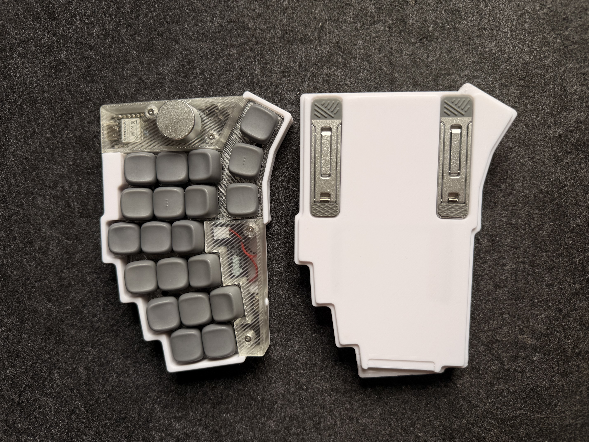
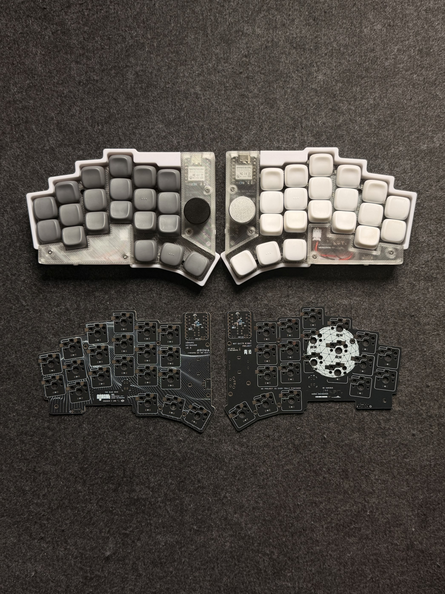
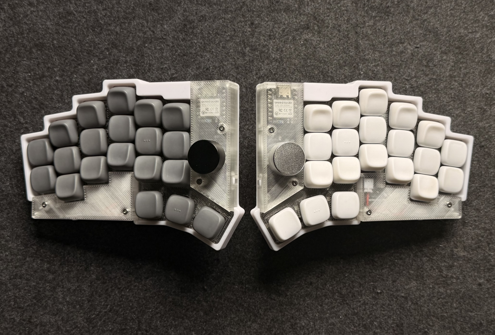

<picture align="center">
  <source media="(prefers-color-scheme: dark)" srcset="docs/images/IMG_8813.jpeg">
  <source media="(prefers-color-scheme: light)" srcset="docs/images/IMG_8813.jpeg">
  
</picture>

<h1 align="left">AŌNAMI</h1>

A wireless ergonomic split keyboard featuring 40 keys and 2 encoders. Designed around the Seeed Studio XIAO nRF52840

## Features

- Fully open sourced hardware & firmware
- Reversible PCB
- Two possible formats
    - Low Profile with a 200mAh battery
    - Tentable with a 600mAh battery
- Choc v1/v2 hot swappable switches
- Choc spacing
- ZMK firmware for remapping keys
- Fully wireless or wired through USB-C

## PCB

You can check the source Ergogen files used to design this keyboard [here](/ergogen/). If you want the ready-to-order gerber files you can check them out [here](/pcbs/).

## Firmware

- [ZMK Precompiled](/firmware/). This is still a work in progress, there are a lot of tailor-made combos for myself and some extra layers that may not be as useful to you. If you want to adjust it to your needs check out the ZMK Source.
- [ZMK Source](https://github.com/notquiterightx/zmk-config-aonami)

## Case

### Tenting

The Maker World case project can be found [here](https://makerworld.com/en/models/3670155-aonami-keyboard-tenting-case#profileId-4213444). Alternatively, you can access the STEP or 3MF files [here](/case/).

### Low Profile
[The case for the low-profile format is still a WIP]

## Gallery
### Tenting Build

\
\
\
\

### Low Profile Build
[The low profile build is still ongoing]

***

## Inspiration
The design of this keyboard wouldn't have been possible without many open source projects that I've learned a lot from. Here are some of the ones that made the most impact:
- [TOTEM by GEIST](https://github.com/GEIGEIGEIST/TOTEM) (and all of his keyboards for that matter)
- [Pica40 by zzeneg](https://github.com/zzeneg/pica40)
- [Flake by Lever Tech](https://github.com/lever-tech/flake)

***
If you end up building this keyboard, don't hesitate to reach out to me and give me any feedback or pictures you may have. This project has taken some time and I'd love to see if you end up using it.

If you want to support this project or any other ones I may make in the future, you can [leave me a tip](https://ko-fi.com/notquiteright), but this is still by all means an open source project and you shouln't feel any pressure to do so.