## Keymap
This keymap is still a work in progress and is the one I'm using currently. Take into account I write both in Spanish and English so take every symbol and keycode with a grain of salt.

I have noticed that having lots of layers and combos works best for me, but feel free to change it and share it with me if you want to collaborate on making this as universal as possible!

<picture>
  <source media="(prefers-color-scheme: dark)" srcset="docs/images/aonami_keymap.svg">
  <source media="(prefers-color-scheme: light)" srcset="docs/images/aonami_keymap.svg">
  
</picture>